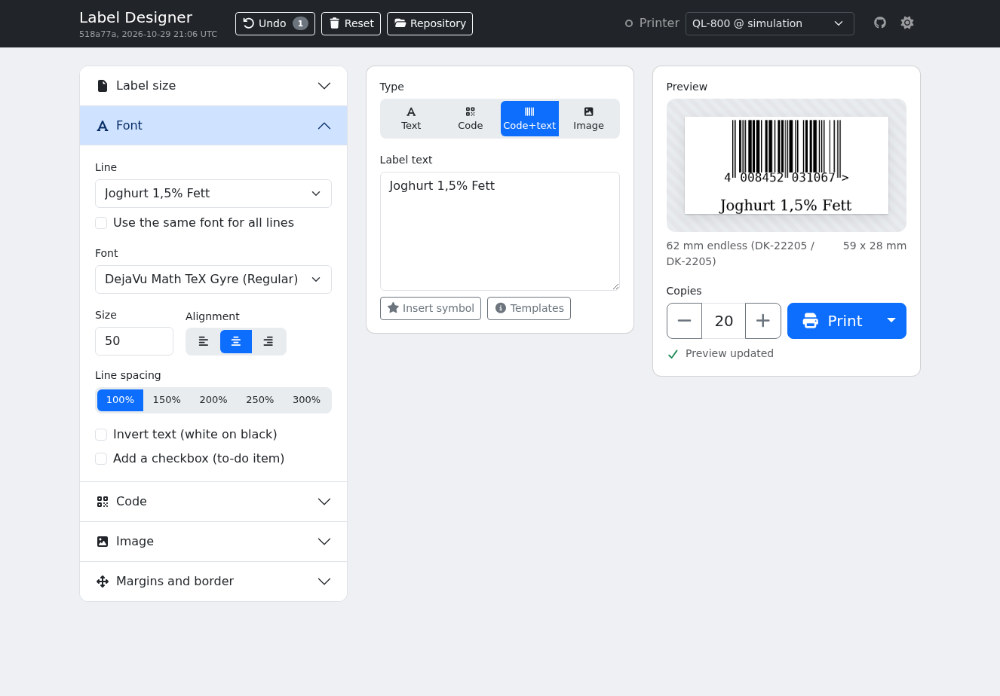
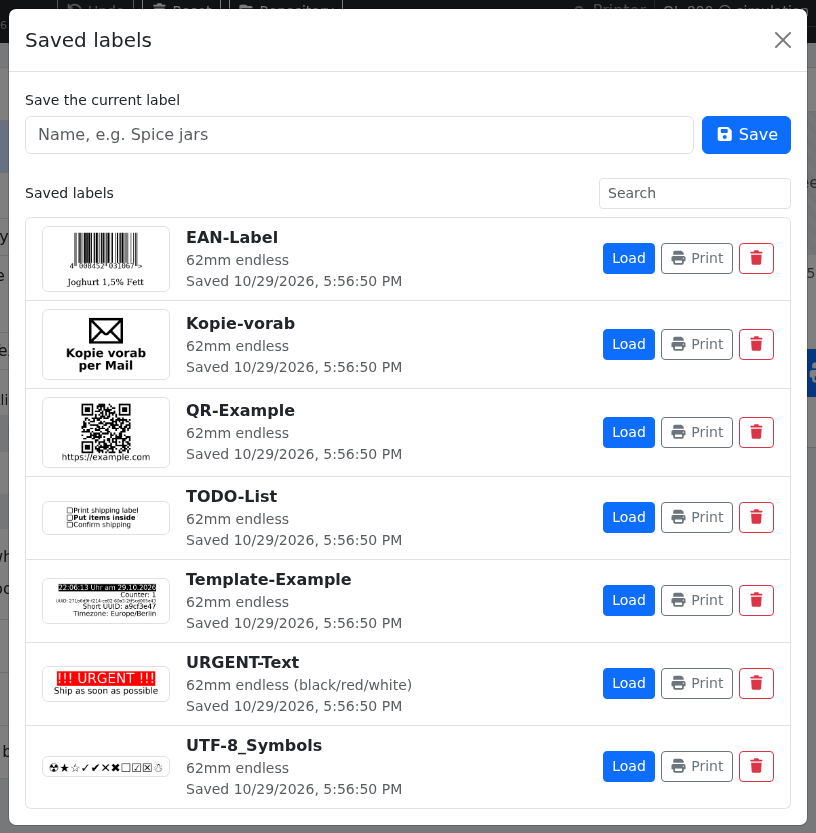
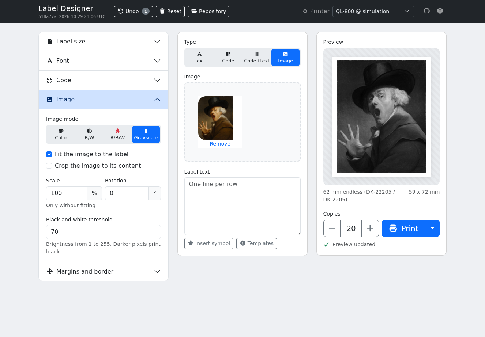
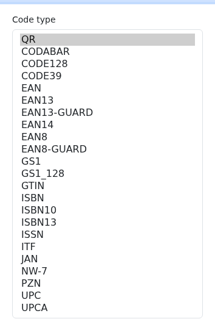
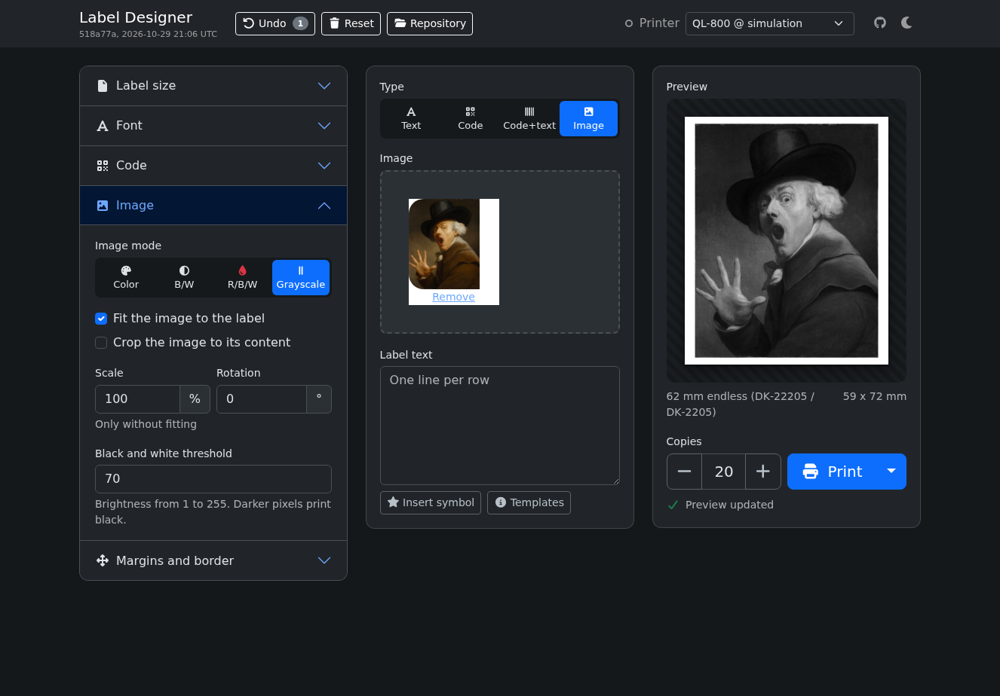
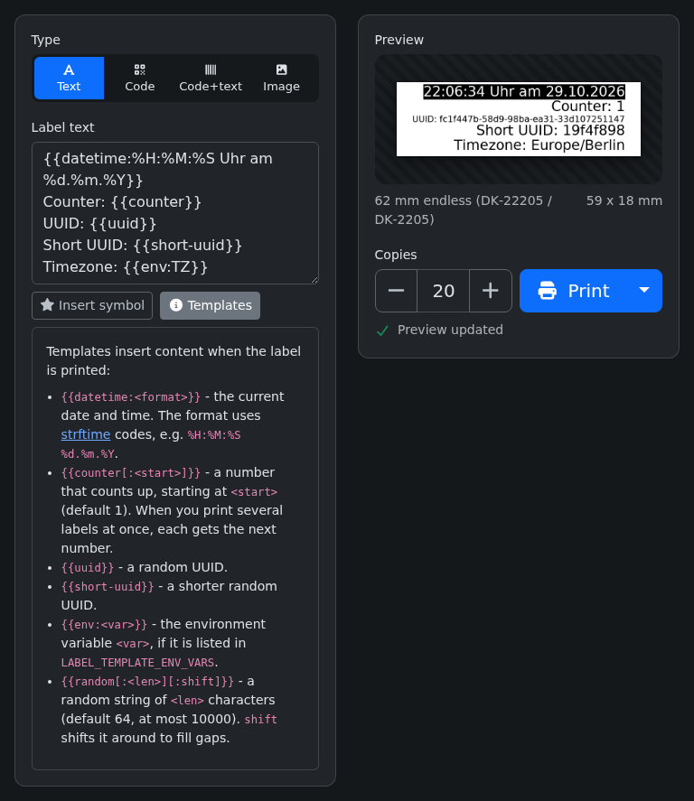
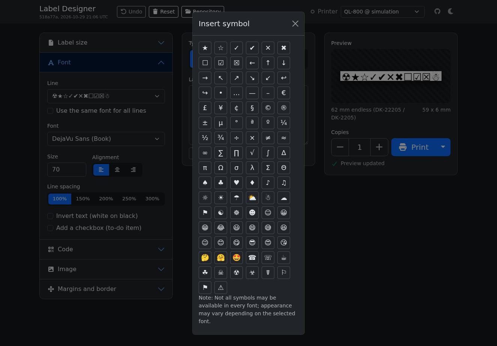

# brother_ql_web

[](https://github.com/DL6ER/brother_ql_web/actions/workflows/ci.yml) [](https://github.com/DL6ER/brother_ql_web/actions/workflows/codeql.yml) [](https://github.com/DL6ER/brother_ql_web/actions/workflows/devcontainer-ghcr.yml)

A web interface and REST API for Brother QL label printers. Design labels with text, QR codes, barcodes and images in the browser, check them in an exact preview and print them, from a computer or a phone. It runs as a Docker container.



## Supported printers

| Printers | Labels |
|---|---|
| QL-500, QL-550, QL-560, QL-570, QL-580N, QL-600, QL-650TD, QL-700, QL-710W, QL-720NW | up to 62 mm wide |
| QL-800, QL-810W, QL-820NWB | up to 62 mm wide, also black/red |
| QL-1050, QL-1060N, QL-1100, QL-1110NWB, QL-1115NWB | up to 103 mm wide, e.g. 4 x 6 in shipping labels |

USB printers are detected automatically, network printers with some limits. The label designer offers only the label sizes the selected printer can print and tells you when another label is loaded.

## Features

- **Text:** font, size, alignment and line spacing for each line, inverted text, checkboxes for to-do lists, red text on black/red labels, optionally shrunk to fit the label
- **Codes:** QR codes and barcodes (EAN, UPC, Code 128, Code 39, ITF, GS1-128, ISBN and more), with or without text
- **Images:** PDFs, one label per page if you like, and dozens of image formats (PNG, JPG, WEBP, AVIF, GIF, TIFF, BMP and many more), dropped, chosen or pasted, alone or together with text, with auto-fit, auto-crop, scaling, rotation and conversion to black/white or black/red
- **Templates:** counters, date and time, UUIDs, random strings and selected environment variables, filled in when printing
- **Label repository:** save, load and print labels, export and import them as JSON
- **Printers:** several printers at once, and a simulator to try everything without a printer
- **Printing:** copies with a cut after every label or only after the last one, borders, round labels, 600 dpi printing
- **Interface:** dark mode, works on phones, can be installed as an app (over HTTPS), which on Android takes images, PDFs and links from the share menu
- **API:** everything the label designer does, described in OpenAPI, and a webhook to print images

## Screenshots

| Label repository | Image with auto-fit |
|---|---|
|  |  |
| **Barcodes** | **Dark mode** |
|  |  |
| **Templates** | **Symbol picker** |
|  |  |

## Installation

With Docker Compose, e.g. with the example [`docker-compose.yml`](./docker-compose.yml):

``` yaml
services:
  brother_ql_web:
    image: ghcr.io/dl6er/brother-ql-web:latest
    container_name: brother_ql_web
    restart: always
    ports:
      - "8013:8013"
    devices:
      - "/dev/usb/lp0:/dev/usb/lp0"
    volumes:
      - ./labels:/app/labels
    environment:
      - PRINTER_MODEL=QL-800
      - PRINTER_PRINTER=file:///dev/usb/lp0
```

Then open `http://<host>:8013`. Saved labels are kept in `./labels`.

To detect printers automatically, also ones plugged in later and network printers, leave out `PRINTER_PRINTER`, `ports` and `devices` and give the container access to USB and the network instead:

``` yaml
    privileged: true
    network_mode: host
    volumes:
      - /dev/usb:/dev/usb
      - ./labels:/app/labels
```

### Image tags

| Tag | Contains | Changes |
|---|---|---|
| `latest` | the newest release | with every release |
| `1` | the newest `1.x` release | with every release of the `1` series |
| `1.0` | the newest `1.0.x` release | with every release of the `1.0` series |
| `1.0.1` | exactly this release | never |
| `dev` | the current state of `master` | with every change and every night |

`latest` is the right choice for most installations. `dev` gets new features and fixes first, e.g. to test a fix from an issue before it is released, but it may also break things. Pre-releases (e.g. `1.1.0-rc.1`) only get their exact tag. To update, run `docker compose pull && docker compose up -d`. All releases are listed on the [releases page](https://github.com/DL6ER/brother_ql_web/releases).

The navbar shows the version and build time of the running image, please add them when you report an issue.

### Settings

| Environment variable | Meaning | Default |
|---|---|---|
| `PRINTER_PRINTER` | The printer: `file:///dev/usb/lp<N>`, `usb://<vendor>:<product>` or `tcp://<host>`, or `?` to detect printers automatically | `?` |
| `PRINTER_MODEL` | Model of a printer that does not report it, e.g. a network printer | `QL-800` |
| `LABEL_DEFAULT_SIZE` | Label size the label designer starts with, e.g. `62` or `103x164` | `62` |
| `LABEL_DEFAULT_ORIENTATION` | `standard` or `rotated` | `standard` |
| `LABEL_TEMPLATE_ENV_VARS` | Environment variables labels may insert with `{{env:<var>}}`, comma-separated. All others stay empty, so that nobody can read secrets of the server through a label. | none |
| `WEBHOOK_PASSWORD` | Turns on the webhook, see [API](#api) | off |
| `TRUSTED_HOSTS` | Host names you open the label designer with, comma-separated, e.g. `labels.local,192.168.0.10`. Requests for other names are refused, which protects against DNS rebinding. | all |
| `PRINT_MAX_COUNT` | Most labels per print request | `100` |
| `MAX_CONTENT_LENGTH` | Largest request in bytes, e.g. for uploaded images | 32 MB |
| `LOG_LEVEL` | `DEBUG`, `INFO`, `WARNING`, `ERROR` or `CRITICAL` | `WARNING` |

Other settings, e.g. the default font and margins, go into `instance/application.py`, see [`config.py`](./config.py). Environment variables take precedence over it. An invalid value stops the server at startup with a message naming the variable.

Fonts: the label designer offers all `.ttf` and `.otf` fonts it finds in the system font folders when it starts. The image comes with DejaVu, Droid, FreeFont, Liberation, Noto and Inconsolata. To add fonts, mount a folder with them, e.g. `./fonts:/usr/local/share/fonts/custom:ro`, and restart the container. A saved label whose font is not installed is shown and printed with the default font, and the preview says so.

Network printers are found when they announce themselves like for Bonjour, which in Docker needs `network_mode: host`, or by a known MAC address prefix in the ARP table. Add others with `tcp://<IP address>` and please open an issue. Network printers that speak IPP (port 631), e.g. the QL-810W, report their model and errors: jobs are not sent while they report one, and an error after a job is shown like for USB printers. The QL-810W also names loaded die-cut labels, but not endless rolls, and reports an open cover as an error without saying which. Older printers only take print jobs on port 9100 and report nothing.

The printer `simulation` saves the labels as PNG files in `simulated_labels` (the newest 100) instead of printing them.

## API

Everything the label designer does is also available as a REST API. It is described in OpenAPI format in [`app/labeldesigner/openapi.json`](app/labeldesigner/openapi.json), which a running server also serves at `/labeldesigner/api/openapi.json` for tools like Swagger UI, Postman or code generators.

```bash
# Print a text label (lines of text as JSON, without "font" the default font is used)
curl -X POST http://localhost:8013/labeldesigner/api/print \
  -F label_size=62 -F 'text=[{"text": "Hello", "size": "70"}]'

# Print the first page of a PDF on a 103 x 164 mm label
curl -X POST http://localhost:8013/labeldesigner/api/print \
  -F label_size=103x164 -F model=QL-1100 -F print_type=image -F image=@label.pdf

# Generate the label image without printing
curl -X POST http://localhost:8013/labeldesigner/api/preview \
  -F 'text=[{"text": "Hello", "size": "70"}]' -o label.png

# Status of the printers
curl http://localhost:8013/labeldesigner/api/printer_status

# Print images with the webhook (needs WEBHOOK_PASSWORD)
curl -X POST http://localhost:8013/labeldesigner/api/webhook/print \
  -H "Authorization: Bearer $WEBHOOK_PASSWORD" -F label_size=62 -F images=@label.png
```

- A request selects a printer with the `printer` parameter: the configured printer, `simulation`, or a printer given as for `PRINTER_PRINTER`. Address each printer in one way only (e.g. always `file:///dev/usb/lp0`), two addresses of the same printer are not recognized as one, and their jobs could get in each other's way.
- Requests that print, save or delete labels must be `POST` requests and are refused when a browser sends them from another website, so that a malicious page cannot use your printer. Scripts and `curl` are not affected.
- Text lines may have up to 10000 characters (100000 per label) after the templates are filled in, barcodes up to 1000. Labels and images may have up to 64 million pixels, enough for a 62 mm wide label of about 2 m at 600 dpi. Of PDFs the first page is printed, or the pages `pdf_pages` selects (e.g. `1-3, 5` or `all`), each as a label of its own.

## Development

The repository has a development container for [VS Code](https://code.visualstudio.com/) with everything needed. It does not mount USB printers, add them in `.devcontainer/devcontainer.json` if you need them. The tests run in Python 3.15 for Alpine Linux, the base image of the published container:

```bash
pip install -r requirements-dev.txt
pytest
```

The tests in `tests/browser` open the label designer in Chromium and are skipped unless Playwright is installed. Playwright does not run on Alpine, so outside the devcontainer:

```bash
pip install -r requirements-browser.txt
python -m playwright install --with-deps chromium
pytest tests/browser
```

To build the image yourself, with the commit and build time shown in the navbar:

```bash
docker compose build --build-arg GIT_COMMIT=$(git rev-parse HEAD) --build-arg BUILD_DATE=$(date -u +%Y-%m-%dT%H:%M:%SZ)
```

Pull requests are welcome: [fork the repository](https://github.com/DL6ER/brother_ql_web/fork), make your changes with tests and open a pull request with a clear description.

## Credits and license

This fork of [`pklaus/brother_ql_web`](https://github.com/pklaus/brother_ql_web) talks to the printers with [`matmair/brother_ql-inventree`](https://github.com/matmair/brother_ql-inventree) and builds on improvements from [`tbnobody/brother_ql_web`](https://github.com/tbnobody/brother_ql_web), [`dersimn/brother_ql_web`](https://github.com/dersimn/brother_ql_web) and [`davidramiro/brother_ql_web`](https://github.com/davidramiro/brother_ql_web), for which we are grateful.

It is published under the terms of the GPLv3, see [LICENSE](./LICENSE). It includes software of third parties under other licenses:

- [Bootstrap](https://github.com/twbs/bootstrap), MIT License
- [Font Awesome](https://github.com/FortAwesome/Font-Awesome), CC BY 4.0 License
- [jQuery](https://github.com/jquery/jquery), MIT License
