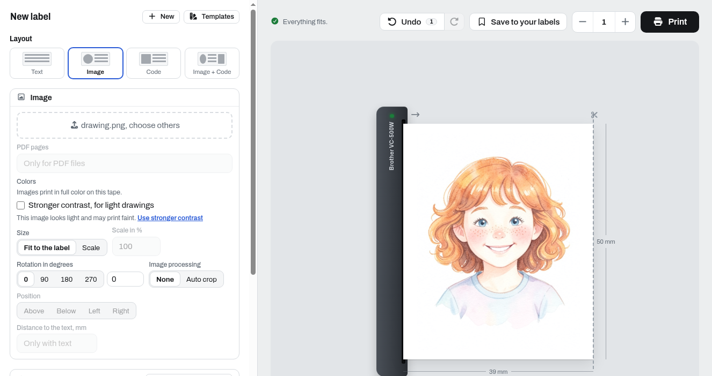

# VC-500W

Measurements on the VC-500W with firmware 2026031522.

## Tape widths

Each cassette tells the printer the width of its tape and the width it prints across it, a little beyond both edges:

| Tape | Tape width | Print width |
|---|---|---|
| 9 mm | 0.367 in | 0.413 in |
| 12 mm | 0.489 in | 0.535 in |
| 19 mm | 0.734 in | 0.779 in |
| 25 mm | 0.978 in | 1.022 in |
| 50 mm | 1.927 in | 2.0 in |

## Calibration

Labels sent as raw RGB: each row of the image is one line along the tape, 1/317 inch in quality and 1/264 inch in fast printing, and each pixel of a row one dot across it at 320 dpi. The images were 20 dots wider than the tape. Wedges at all four edges, growing by one dot or row per millimeter, show how far the image reaches beyond each edge of the tape and how many rows the cuts take off.

| Tape | Tape in dots | Image in dots | Dots beyond the edge at the first pixel | Dots beyond the edge at the last pixel | Rows cut off at the end that comes out first | Rows cut off at the other end |
|---|---|---|---|---|---|---|
| 9 mm | 117.4 | 137 | 12.5 | 5 | 12.5 | 13 |
| 12 mm | 156.5 | 176 | 11.5 | 10.2 | 10 | 10 |
| 19 mm | 234.9 | 254 | 12.5 | 8.5 | 9.5 | 9.5 |
| 25 mm | 313.0 | 332 | 13.5 | 7.5 | 8.5 | 9.5 |
| 50 mm | 616.6 | 636 | 14.5 | 6.5 | 11.5 | 8.5 |

The tape in dots is its width in inches times 320. The printer centers a row about 3 dots toward its first pixel, and the cuts take off about 10 rows (0.8 mm) at both ends.

A JPEG is scaled to the print width across the tape and printed at 313 lines per inch along it, 308.5 on 50 mm tape, in both modes. A 60 mm frame came out 60.0 mm long on all five tapes. A JPEG that is not wider than high is turned by 90 degrees.

## Speed

The time from the start of printing to ejecting, on 25 mm tape:

| Mode | Lines per inch | 25.4 mm label | 66 mm label | Printing speed |
|---|---|---|---|---|
| Quality | 317 | 10.7 s | 21.6 s | 3.4 mm/s |
| Fast | 264 | 6.8 s | 15.5 s | 4.7 mm/s |

Before that the printer prepares for 10 to 12 s and sometimes preheats for 2 to 10 s, afterwards it ejects the label for 8 to 9 s. From the start of the job to idle, a 25.4 mm label took 38 s in quality and 26 s in fast printing, not counting the time to send its data.

The printer's black and white mode ("Deep black") printed the same as quality, in full color and in the same time.

## Tape use

- A full cut leaves a 9 mm tab of backing before the label.
- A half cut, "manual cut" in Brother's app, leaves a tab on both sides of the label.
- Labels printed one after the other with half cuts form a strip, with a 4.5 mm piece between two half cuts before each label.
- Labels that are not cut stay in the printer. The next job prints right behind them without a cut, a thin cyan line can show where the tape waited under the print head.
- A new cassette feeds about 48 mm of leader when it is put in.

## Cassette

A cassette that is put in is ready after about 6 s: 1 s to read it, 5 s to load the tape. A cassette that was in the printer before feeds no measurable tape then. The cassette button winds the tape back for about 3 s.

## Colors

On the ZINK paper, green and blue print dim, and a color area blurs slightly where it begins. Saturating the colors twice as much, e.g., `#c00000` to `#fe0000`, made red visibly brighter, so the label designer does that before printing.

Drawings in light washes still print faint. Of four steps printed on 50 mm tape, the strongest looked best: luma to the power of 2.2, the darkest 0.5 % of the image black, color differences 1.5 times. Photos look right without it, so it is a setting of the image (`image_contrast`), which the label designer suggests when an image is light all over.

## Sleep

When the printer sleeps, it still answers on the network, a little slower, and its status shows no difference. A job wakes it.
